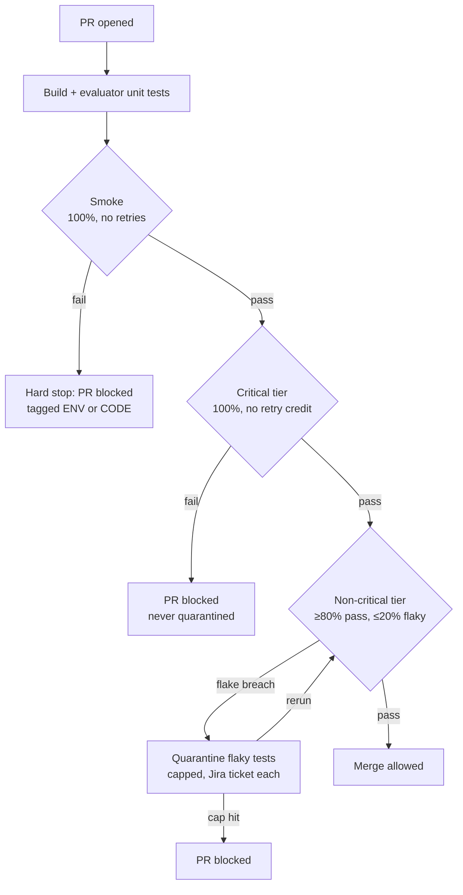

# CI Quality Gates

**A CI pipeline whose quality gates are a written, enforced contract.** QA defines what a green build means, the pipeline enforces it from one config file, and every failure says what broke, who owns it and what to do next.

This is a portfolio project. The test suites are small on purpose: 25 tests. The design, the decisions and the failure handling are the point.

## What green means



| Gate | Pass rule | Retries | On failure |
|---|---|---|---|
| Smoke | 100% | 0 | Hard stop, later gates skipped, failure tagged ENV or CODE |
| Critical tier | 100%, a pass on retry still fails | 1, to detect flakiness | PR blocked, never quarantined |
| Non-critical tier | ≥ 80% pass and ≤ 20% flaky | 1 | Flake breach: quarantine, ticket, rerun. Otherwise the PR is blocked |

The full rules, with owners and runbooks, are in **[CI_CONTRACT.md](CI_CONTRACT.md)**. Every number lives in **[quality-gates.yml](quality-gates.yml)**.

## Proof

| Claim | Where to check |
|---|---|
| The contract is written down | [CI_CONTRACT.md](CI_CONTRACT.md) |
| Thresholds live in config, not in workflows | [quality-gates.yml](quality-gates.yml), read by [the gate evaluator](gate-evaluator/src/main/java/io/github/samikshapatel/qg/gate/GateEvaluator.java) |
| Every branch of the contract is tested | [GateEvaluatorTest](gate-evaluator/src/test/java/io/github/samikshapatel/qg/gate/GateEvaluatorTest.java) |
| Each failure path can be shown on demand | Actions → **Quality gates** → **Run workflow** → pick a scenario |
| Decisions are reasoned | [docs/adr/](docs/adr) |
| Every failure has a runbook | [docs/runbooks/](docs/runbooks) |
| Frozen results of each scenario | [docs/evidence/](docs/evidence) |
| The contract is not tied to one CI tool | [Jenkinsfile](Jenkinsfile) calls the same scripts |

## Demo scenarios

Go to **Actions → Quality gates → Run workflow** and choose one. Each takes about 10 minutes.

| Scenario | What happens | Expected result |
|---|---|---|
| `none` | Normal run | All three gates pass |
| `env-down` | The API container is stopped | Smoke fails, **ENV**, owner DevOps |
| `smoke-code` | A smoke test expects the wrong status | Smoke fails, **CODE**, owner PR author |
| `critical-flake` | A critical test fails once, then passes | Critical fails: no retry credit |
| `flake-breach` | 3 non-critical tests fail once, then pass | Flake rate 21.4% leads to quarantine, a Jira ticket each, and a rerun that passes |
| `quarantine-cap` | 6 non-critical tests fail once, then pass | Quarantine refused at the cap of 5, PR blocked |

The scenarios use [deliberate fault tests](docs/adr/0005-deliberate-fault-tests.md). They are deterministic, and excluded from every normal run.

## The run report

Every run writes one report: in the job summary, as a sticky PR comment, and as `gate-results/run-report.md`. It says what happened, what the pipeline did, and who acts next. On a breach, `gate-results/quality-gate-failure.txt` carries the same facts for scripts.

| Failure | Pipeline action | Owner |
|---|---|---|
| Smoke, ENV | Build failed, PR blocked | DevOps |
| Smoke, CODE | Build failed, PR blocked | PR author |
| Critical tier | Build failed, PR blocked | PR author, QA reviews |
| Non-critical flake breach | Quarantine, Jira ticket, rerun | QA, with the test's author |
| Quarantine cap hit | Build failed, PR blocked | QA lead |

## Systems under test

| System | Layer | Where it runs | Why |
|---|---|---|---|
| [Restful-Booker](https://github.com/mwinteringham/restful-booker) | API | Docker, inside CI | The public instance resets every 10 minutes; a private copy is an environment the gates control |
| [SauceDemo](https://www.saucedemo.com) | UI | Public site | A static site built for automation practice, with no shared data |

## Stack

Java 21 · Maven · RestAssured · Playwright for Java · JUnit 5 · GitHub Actions · Jenkins · Jira Cloud · Docker Compose · Allure results

```
quality-gates.yml       every threshold, cap, pattern and owner
CI_CONTRACT.md          what green means, who acts on what
quarantine.json         current quarantine, written by the gate
test-support/           quarantine skipping, tier tags, deterministic fault markers
gate-evaluator/         reads Surefire XML, applies the gates, writes the run report, opens Jira tickets
api-tests/              13 RestAssured tests + deliberate fault tests
ui-tests/               12 Playwright tests
scripts/                run-gate.sh, run-regression.sh (shared by GitHub Actions and Jenkins)
.github/workflows/      pr.yml (gates + scenarios), nightly.yml (quarantine review), release.yml (evidence pack)
docs/                   test plan, ADRs, runbooks, evidence
```

## Workflows

- **Quality gates** (`pr.yml`) runs on every PR and from the Run workflow button. Smoke runs first, then the critical tier, then the non-critical tier. It posts the run report on the PR and uploads evidence.
- **Nightly** (`nightly.yml`) runs the full gates on `main`, then reviews quarantine: quarantined tests run and build a green streak. A test is released after 7 clean nights, and one older than 14 days fails the run.
- **Release** (`release.yml`) runs on a `v*` tag. It runs the gates on the tagged commit and publishes a GitHub release with an evidence pack attached.

## Setup

1. **Branch protection:** Settings → Branches → add a rule for `main`, require a PR, and require the **Smoke → Critical → Non-critical** status check.
2. **Secrets and variables:** Settings → Secrets and variables → Actions. Only credentials are secrets. The Jira site and project key are plain variables, because GitHub masks every secret value in logs and reports, which would turn ticket links into `***-1`.

   | Name | Kind | Purpose | Required |
   |---|---|---|---|
   | `JIRA_EMAIL`, `JIRA_API_TOKEN` | Repository secret | Quarantine tickets | No: without them, tickets are skipped and the report says so |
   | `JIRA_BASE_URL`, `JIRA_PROJECT_KEY` | Repository variable | Jira site and project for tickets | With the two secrets above |
   | `RB_USERNAME`, `RB_PASSWORD` | Restful-Booker auth | No: falls back to the public demo defaults |
   | `SAUCE_USERNAME`, `SAUCE_PASSWORD` | SauceDemo login | No: falls back to the public demo defaults |

3. **Jenkins (optional):** create the four Jira credentials named in the `Jenkinsfile`, and point a Pipeline job at this repo.

## Run locally

```bash
docker compose -f docker-compose.ci.yml up -d --build --wait
mvn -B install -pl test-support,gate-evaluator -am      # build + evaluator unit tests
mvn -B test-compile -pl api-tests,ui-tests
mvn -B -q -pl ui-tests exec:java@install-browsers         # Chromium for Playwright
mkdir -p gate-results
scripts/run-gate.sh smoke && scripts/run-gate.sh critical && scripts/run-regression.sh
java -jar gate-evaluator/target/gate-evaluator.jar report
DEMO_SCENARIO=flake-breach scripts/run-regression.sh       # try a scenario
```
